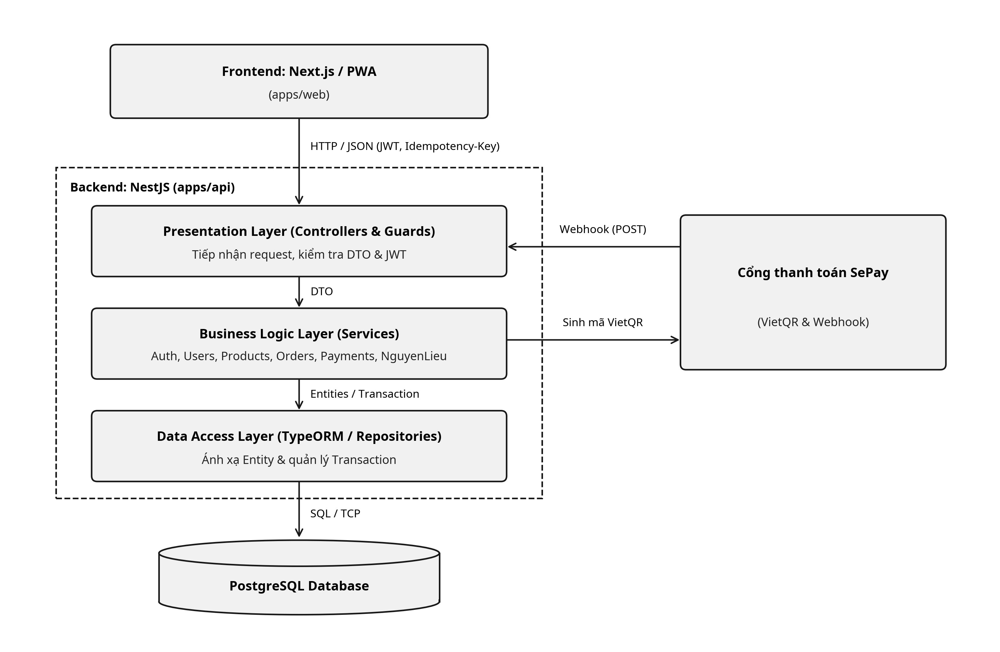

# Tài liệu Mô tả Kiến trúc Hệ thống - BrewLite

## 1. Tổng quan và Phương pháp Kiến trúc

Hệ thống **BrewLite** được thiết kế dựa trên sự kết hợp giữa mô hình **C4 Model** (cấp độ System Context và Container) để biểu diễn tổng thể các khối triển khai và **Kiến trúc phân lớp theo module nghiệp vụ (Modular Monolith)** cho phần lõi Backend (theo quyết định tại [ADR-002](./adr/002-layered-architecture.md)). Toàn bộ mã nguồn, tài liệu kỹ thuật và bộ kiểm thử được tổ chức tập trung theo cấu trúc **Monorepo** (theo quyết định tại [ADR-001](./adr/001-monorepo.md)).

### 1.1. Sơ đồ Kiến trúc Tổng thể (C4 Container Level)

### 1.2. Kiến trúc Phân lớp trong mỗi Module (Layered Architecture)

Theo [ADR-002](./adr/002-layered-architecture.md), bên trong Backend (`apps/api/src/` hoặc `backend/src/` theo tiến độ chuyển đổi repo), kiến trúc được phân lớp ở cấp ứng dụng và module với hai luồng xử lý thống nhất:
* **Luồng xử lý yêu cầu từ người dùng:** `Next.js / PWA -> Controller -> Service -> TypeORM / Repository -> PostgreSQL`.
* **Luồng nhận trạng thái thanh toán từ SePay:** `SePay (Webhook) -> PaymentsController -> PaymentsService -> PostgreSQL`.

Trách nhiệm của từng lớp được tách biệt rõ ràng:
1. **Presentation Layer (Controllers, DTOs & Guards):** Tiếp nhận HTTP request (hoặc Webhook từ SePay) và trả response, kiểm tra định dạng dữ liệu đầu vào thông qua `ValidationPipe` và DTO (giúp tách cấu trúc giao tiếp HTTP khỏi entity lưu trữ), trích xuất `Idempotency-Key`, xác thực JWT (`JwtStrategy`), kiểm tra phân quyền truy cập và xác thực `API_KEY` trong Header `Authorization: Bearer <token>` từ SePay. Controller được giữ mỏng, không chứa quy tắc nghiệp vụ hay truy vấn cơ sở dữ liệu trực tiếp.
2. **Business Logic Layer (Services):** Thực thi và điều phối quy tắc nghiệp vụ cốt lõi của từng module (tính tổng tiền theo size/topping, khởi tạo PostgreSQL Transaction, kiểm tra khóa `Idempotency-Key` và mã giao dịch `transaction_id`, sinh mã VietQR động qua chuẩn Napas 247 của SePay, đối soát số tiền/mã đơn hàng từ Webhook và cộng dồn hoặc trừ định mức tồn kho).
3. **Data Access Layer (TypeORM / Repositories & Entities):** Ánh xạ các thực thể miền với bảng dữ liệu trong PostgreSQL thông qua `TypeOrmModule.forFeature(...)`, thực thi truy vấn và quản lý giao dịch nguyên tử (`DataSource` / `QueryRunner`).

---

## 2. Chi tiết các Thành phần Kiến trúc

### 2.1. Frontend: Next.js / PWA (`apps/web`)
* **Thiết kế Mobile-First & PWA:** Giao diện xây dựng bằng Next.js tuân thủ định hướng ưu tiên thiết bị di động (mobile-first) và cấu hình Web App Manifest cùng Service Worker để người dùng cài đặt trực tiếp lên điện thoại như một ứng dụng Progressive Web App (PWA) (đáp ứng **NFR-01**).
* **Quản lý trạng thái, Hiển thị VietQR & Chống gửi lặp yêu cầu:** Quản lý giỏ hàng và tính toán tổng tiền theo thời gian thực ngay khi khách hàng chọn size hoặc topping (**FR-02**, **FR-03**). Khi khách hàng nhấn nút "Thanh toán", Next.js tự động sinh ra một chuỗi `Idempotency-Key` duy nhất gửi kèm `Bearer JWT` lên Backend để đảm bảo cùng một phiên thanh toán không bị tạo thành nhiều đơn hàng rác hoặc trừ điểm Loyalty nhiều lần khi mạng chậm ([ADR-004](./adr/004-payment-strategy.md)). Sau khi tạo đơn, giao diện hiển thị mã VietQR cùng đồng hồ đếm ngược và liên tục lắng nghe trạng thái đơn hàng qua cơ chế Polling (hoặc Server-Sent Events) tới endpoint `GET /orders/:id/status`.
* **Xử lý trạng thái giao diện:** Đảm bảo hiển thị đầy đủ các trạng thái trung gian gồm `loading` (đang tải), `empty` (danh sách trống) và `error` (thông báo lỗi thân thiện khi API gặp sự cố).

### 2.2. Backend: NestJS theo Module / Domain (`apps/api`)
Ứng dụng Backend được khởi tạo tại `main.ts` (cấu hình `ValidationPipe`, CORS, cổng HTTP) và lắp ghép tại `AppModule` (nạp `ConfigModule`, kết nối TypeORM) từ 6 module nghiệp vụ độc lập, hướng tới mục tiêu thời gian phản hồi thông thường dưới 500ms (**NFR-02**) ([ADR-002](./adr/002-layered-architecture.md)):
* **AuthModule (`auth/` - `FR-04`, `FR-05`, `FR-06`, `NFR-03`):** Đăng ký `AuthController`, `AuthService`, `JwtStrategy` và sử dụng `UsersModule`. Xử lý đăng ký tài khoản (kiểm tra email trùng, validate mật khẩu tối thiểu 8 ký tự và băm mật khẩu trước khi lưu vào PostgreSQL), đăng nhập đối chiếu mật khẩu băm để phát hành token JWT, và cung cấp các Guard phân quyền cho 3 vai trò: `Khách hàng` (chỉ đặt hàng), `Nhân viên` (cập nhật trạng thái đơn) và `Quản lý` (lập hóa đơn nhập kho). Luồng đăng xuất (luồng phụ của `FR-05`) được xử lý stateless bằng cách xóa JWT và trạng thái phiên ở phía ứng dụng Next.js.
* **UsersModule (`users/`):** Quản lý thông tin tài khoản người dùng (`User`) và lịch sử biến động điểm tích lũy (`LoyaltyTransaction`).
* **ProductsModule (`products/` - `FR-01`, `FR-02`):** Cung cấp các endpoint `GET /products` và `GET /products/:id` để truy xuất danh sách menu, chi tiết sản phẩm, tùy chọn kích cỡ (size) và topping.
* **OrdersModule (`orders/` - `FR-07`, `FR-08`, `FR-09`):** Gom `OrdersController`, `OrdersService` cùng các thực thể liên quan đến đơn hàng (`Order`, `OrderItem`, `Promotion`), sản phẩm và người dùng. Xử lý luồng tạo đơn hàng, cung cấp endpoint `GET /orders/:id/status` để Frontend lắng nghe trạng thái đơn, cho phép khách hàng xem lịch sử đơn và nhân viên quầy cập nhật trạng thái đơn hàng.
* **PaymentsModule (`payments/` - `FR-07`):** Gom `PaymentsController`, `PaymentsService` và thực thể `Payment` để tích hợp cổng thanh toán SePay ([ADR-002](./adr/002-layered-architecture.md), [ADR-004](./adr/004-payment-strategy.md)). Module chịu trách nhiệm tạo mã thanh toán định danh, sinh URL ảnh VietQR động qua chuẩn Napas 247 của SePay, tiếp nhận thông báo biến động số dư tại endpoint `@Post('payments/sepay/webhook')`, kiểm tra số tiền/mã đơn hàng và xử lý an toàn chống trùng lặp giao dịch (`Idempotency-Key` và `transaction_id`).
* **NguyenLieuModule (`NguyenLieu/` - `FR-10`, `FR-11`):** Giữ tên thư mục `NguyenLieu` theo quy ước hiện có trong repository. Quản lý định mức nguyên liệu và phục vụ chức năng lập hóa đơn nhập hàng dành riêng cho Quản lý (`POST /import-invoices`). Khi hóa đơn được lưu thành công, hệ thống sử dụng Database Transaction để tự động cộng dồn số lượng tồn kho tương ứng, tuyệt đối không cho phép chỉnh sửa tồn kho thủ công độc lập.

### 2.3. Cơ sở dữ liệu PostgreSQL, Cơ chế Migration và Transaction
Theo quyết định kiến trúc tại [ADR-003](./adr/003-database-migration.md), hệ thống quản lý dữ liệu trên PostgreSQL thông qua TypeORM với lộ trình và quy chuẩn rõ ràng:
* **Lưu trữ bền vững (Persistent Storage):** PostgreSQL lưu trữ toàn bộ các thực thể miền theo Class Diagram (Task 2.3) bao gồm: `User`, `Product`, `Order`, `OrderItem`, `Payment`, `Promotion`, `LoyaltyTransaction` và nhóm thực thể quản lý kho `NguyenLieu`.
* **Lộ trình chuyển đổi sang TypeORM Migration & Seed (`database/`):**
  * Giải quyết lưu ý tại [ADR-002](./adr/002-layered-architecture.md) (việc `AppModule` bật `synchronize: true` ở giai đoạn phát triển ban đầu) bằng cách trích xuất lược đồ thành Initial Migration chuẩn và chuyển sang `synchronize: false` trên quy trình chuẩn và môi trường Production. Toàn bộ thay đổi lược đồ được quản lý qua các script chuẩn (`migration:generate`, `migration:run`, `migration:revert`, `seed:run`) cùng cấu hình `data-source.ts` độc lập.
  * Mỗi tệp migration gắn nhãn thời gian (`timestamp`), định nghĩa đầy đủ 2 chiều nâng cấp (`up` - bao gồm tạo bảng, khóa ngoại và ràng buộc `UNIQUE` cho `idempotency_key` cũng như mã tham chiếu giao dịch SePay) và hoàn tác (`down`), tuân thủ quy tắc bất biến sau khi merge và thực thi an toàn trong từng giao dịch riêng (`migrationsTransactionMode: 'each'`) nhờ tính năng Transactional DDL của PostgreSQL.
  * Kịch bản `seeds/` nạp dữ liệu mẫu (menu đồ uống, size/topping, nguyên liệu, khuyến mãi, tài khoản test) giúp tái tạo 100% cơ sở dữ liệu khi chạy `docker-compose.yml` ở local và phục vụ kiểm thử tự động trên CI.
* **Đảm bảo toàn vẹn dữ liệu bằng PostgreSQL Transaction (ACID):**
  * Sử dụng `dataSource.transaction(...)` tại tầng Service cho luồng đặt đơn (`OrdersService`), nơi cần lưu đồng thời `Order`, `OrderItem`, trừ số lượng trong `NguyenLieu`/`Product`, ghi nhận `LoyaltyTransaction` và khởi tạo thông tin thanh toán `Payment` cho SePay (cũng như luồng lập hóa đơn nhập kho). Nếu bất kỳ điều kiện nghiệp vụ nào không thỏa mãn (như hết nguyên liệu, mã khuyến mãi hết lượt hoặc giao dịch SePay thất bại), Service ném ra Exception và TypeORM tự động `ROLLBACK` toàn bộ các câu lệnh ghi trước đó.
  * Sử dụng `QueryRunner` kết hợp khóa bi quan (`pessimistic_write`) và cấu trúc `try ... catch ... finally` (bắt buộc gọi `await queryRunner.release()` trong `finally` để tránh rò rỉ kết nối) cho các thao tác có nguy cơ tranh chấp cao (Race Condition) như khi nhiều khách hàng cùng đặt phần nguyên liệu cuối cùng, hoặc khi xử lý yêu cầu thanh toán và nhận Webhook callback xác nhận giao dịch từ SePay kèm `Idempotency-Key` trong `PaymentsService`.

### 2.4. Tích hợp Cổng Thanh toán SePay QR và Xử lý Idempotency
Theo quyết định kiến trúc tại [ADR-004](./adr/004-payment-strategy.md), hệ thống triển khai **Phương án 1: Tích hợp trực tiếp cổng thanh toán SePay QR** kết hợp cơ chế chống xử lý trùng (**Idempotency**) ở hai cấp độ:
* **Khởi tạo thanh toán & Sinh VietQR động:**
  * *Ở Backend:* Khi tạo đơn hàng thành công (trạng thái chờ thanh toán), NestJS API tạo mã thanh toán định danh duy nhất và sinh URL ảnh VietQR qua chuẩn Napas 247 của SePay chứa đúng số tiền, số tài khoản nhận và nội dung chuyển khoản bắt buộc.
  * *Ở Frontend:* Next.js hiển thị mã QR cùng đồng hồ đếm ngược (hỗ trợ nút "Quay lại" giỏ hàng nếu khách đổi ý, hoặc tự động hủy đơn nếu quá hạn 10 phút không có Webhook trả về theo SRS) và liên tục lắng nghe trạng thái đơn qua cơ chế Polling (hoặc Server-Sent Events) tới endpoint `GET /orders/:id/status`.
* **Tiếp nhận & Xác thực Webhook từ SePay:**
  * Xây dựng endpoint `@Post('payments/sepay/webhook')` trên `PaymentsController` để nhận thông báo biến động số dư khi khách hàng chuyển khoản thành công, sau đó `PaymentsService` kiểm tra đối chiếu số tiền, mã đơn hàng và cập nhật trạng thái đơn trong PostgreSQL.
  * *Bảo mật Webhook:* Kiểm tra `API_KEY` của SePay gửi kèm trong Header `Authorization: Bearer <token>` để ngăn chặn các request giả mạo biến động số dư.
* **Cơ chế chống xử lý trùng 2 cấp độ (Idempotency):**
  * *Ở cấp độ Khách hàng:* Áp dụng `Idempotency-Key` sinh từ Frontend cho các thao tác bấm tạo đơn/yêu cầu sinh QR, đảm bảo cùng một phiên thanh toán không bị tạo thành nhiều đơn hàng rác hoặc trừ điểm Loyalty nhiều lần khi mạng chập chờn.
  * *Ở cấp độ Webhook:* Do SePay có cơ chế tự động gửi lại (retry) nhiều lần nếu mạng chậm, Backend lưu lại `transaction_id` (mã giao dịch ngân hàng từ payload SePay) vào bảng `payments` trong PostgreSQL. Nếu nhận request có `transaction_id` đã tồn tại và đơn hàng đã ở trạng thái `PAID`, hệ thống lập tức phản hồi `HTTP 200 { success: true }` mà không cập nhật đơn hàng lần 2.

### 2.5. Logging, Health Check và Quản lý Cấu hình
Các mối quan tâm xuyên suốt (Cross-cutting Concerns) được định hướng chuẩn hóa như sau:
* **Logging:**
  * Thiết lập ghi nhật ký có cấu trúc (Structured Logging) tại tầng API cho các HTTP request/response (bao gồm method, đường dẫn, mã trạng thái HTTP và thời gian phản hồi tính bằng ms để giám sát mục tiêu **NFR-02** < 500ms).
  * Ghi log các ngoại lệ (Exception stack traces) và các sự kiện nghiệp vụ quan trọng (kiểm tra idempotency, tạo đơn, đối soát webhook SePay, nhập kho). Tuyệt đối không ghi mật khẩu gốc hay chuỗi secret/JWT/khóa xác thực SePay vào log (**NFR-03**).
* **Health Check:**
  * Chuẩn hóa endpoint `GET /health` tại Backend để kiểm tra trạng thái hoạt động của tiến trình NestJS và kết nối thực tế tới PostgreSQL.
  * Endpoint này phục vụ cấu hình `docker-compose.yml` và bước **Smoke Test** trong pipeline CI/CD (Task 5.3) nhằm xác nhận hệ thống hoạt động ổn định ngay sau khi chạy `migration:run` trên production, hoặc kích hoạt quy trình dừng pipeline và rollback (`migration:revert`) nếu thất bại.
* **Quản lý cấu hình (Configuration Management):**
  * Tách biệt hoàn toàn cấu hình nhạy cảm, thông tin kết nối cơ sở dữ liệu, `JWT_SECRET` và thông tin xác thực/khóa webhook SePay khỏi mã nguồn thông qua biến môi trường (`ConfigModule` / `ConfigService` và tệp `data-source.ts`), không ghi cứng (hardcode) bí mật vào mã nguồn.
  * Kho mã nguồn chỉ lưu trữ tệp mẫu `.env.example` ở thư mục gốc của Monorepo, còn tệp `.env` thực tế bị loại trừ qua `.gitignore`.
  * Trên môi trường CI/CD và Production, các thông tin nhạy cảm được tiêm trực tiếp thông qua cơ chế **Secrets Management** của GitHub Actions và nền tảng Cloud triển khai; cơ sở dữ liệu production có persistent storage và nằm trong mạng nội bộ, không mở public trực tiếp ra ngoài.

---

## 3. Lý do Lựa chọn Kiến trúc, Ưu điểm, Hạn chế và Trade-off

### 3.1. Lý do lựa chọn kiến trúc (Rationale)
Nhóm lựa chọn kiến trúc **Modular Monolith kết hợp Phân lớp (Layered Architecture)** đặt trong **Monorepo**, quản lý dữ liệu bằng **TypeORM Migration & Transaction** và tích hợp **Cổng thanh toán SePay QR kèm Idempotency** vì:
* Tối ưu hóa tốc độ phối hợp cho nhóm 6 thành viên làm việc qua 2 Sprint ngắn hạn; mọi người có thể phân chia làm việc độc lập trên từng module (`auth`, `users`, `products`, `orders`, `payments`, `NguyenLieu`) và khởi chạy toàn bộ hệ thống chỉ với một cấu hình `docker-compose.yml` duy nhất.
* Đảm bảo tính truy vết (Traceability) chặt chẽ: mọi thay đổi từ tài liệu yêu cầu (`docs/requirements/`), sơ đồ (`docs/diagrams/`), kiến trúc (`docs/architecture/`), tệp lịch sử migration đến mã nguồn (`apps/`) và kiểm thử (`tests/`) đều nằm trong cùng một kho lưu trữ.
* Đảm bảo tính nhất quán dữ liệu tức thời (Strong Consistency) và trải nghiệm thanh toán sát thực tế vận hành doanh nghiệp thông qua PostgreSQL Transaction kết hợp kiểm tra `Idempotency-Key` (chống tạo đơn trùng từ phía khách hàng) và `transaction_id` (chống xử lý lặp khi SePay gửi lại Webhook).

### 3.2. Phân tích Ưu điểm, Hạn chế và Sự đánh đổi (Trade-offs)

| Quyết định Kiến trúc | Ưu điểm (Pros) | Hạn chế (Cons) | Sự đánh đổi (Trade-offs) |
| :--- | :--- | :--- | :--- |
| **Tổ chức mã nguồn Monorepo** ([ADR-001](./adr/001-monorepo.md)) | Đồng bộ `apps/web`, `apps/api`, `docs` và `tests` trong 1 repo; dễ dàng truy vết theo `traceability-matrix.md` và chạy toàn hệ thống bằng 1 file `docker-compose.yml`. | Kích thước repository lớn hơn so với Polyrepo; cần cấu hình nhánh và CI rõ ràng để tránh xung đột khi 6 thành viên cùng push code. | Đánh đổi việc quản lý phân quyền tách biệt từng repo con để lấy tốc độ phối hợp nhóm nhanh gọn và tính đồng bộ môi trường tuyệt đối. |
| **Kiến trúc phân lớp theo Module cho NestJS** ([ADR-002](./adr/002-layered-architecture.md)) | Ranh giới nghiệp vụ rõ ràng; luồng `Controller -> Service -> TypeORM/Repository` thống nhất; nghiệp vụ thanh toán SePay được cô lập gọn trong `PaymentsModule`; triển khai đơn giản chỉ với 1 ứng dụng backend. | Các module dùng chung tiến trình và DB; phụ thuộc chéo nếu không kiểm soát `exports` sẽ làm mờ ranh giới module; không thể scale riêng lẻ từng domain như Microservices. | Chấp nhận giới hạn về khả năng scale độc lập và sự phụ thuộc trực tiếp vào TypeORM (không dùng Clean Architecture thuần túy) để đổi lấy tốc độ phát triển MVP nhanh và dễ bảo trì. |
| **TypeORM Migration & PostgreSQL Transaction** ([ADR-003](./adr/003-database-migration.md)) | Tái tạo DB 100% ở mọi môi trường qua Migration & Seed; hỗ trợ rollback schema an toàn trên CD; chống sai lệch tồn kho, điểm thưởng và cộng trùng giao dịch SePay nhờ ACID Transaction & khóa `pessimistic_write`. | Thành viên bắt buộc phải sinh file migration khi sửa Entity; việc khóa dòng dữ liệu làm các request trùng thời điểm phải xếp hàng chờ nhau trong thời gian ngắn. | Đánh đổi sự tiện lợi tức thời của `synchronize: true` và một phần nhỏ độ trễ khi tranh chấp khóa để ưu tiên tuyệt đối tính toàn vẹn dữ liệu giao dịch tài chính và khả năng rollback trên Production. |
| **Tích hợp SePay QR & Idempotency 2 cấp độ** ([ADR-004](./adr/004-payment-strategy.md)) | Cho phép quét mã VietQR (chuẩn Napas 247) chuyển khoản ngân hàng sát thực tế doanh nghiệp; chống tạo đơn rác (`Idempotency-Key`) và chống cập nhật trùng đơn khi SePay retry webhook (`transaction_id`). | Phụ thuộc vào cấu hình và khả năng gửi webhook từ SePay; môi trường local/CI cần mở tunnel (`ngrok` / `localtunnel`) để nhận webhook; khó chủ động ép lỗi `PAYMENT_FAILED` trên cổng thật. | Chấp nhận chi phí cấu hình tunnel/môi trường test cho Webhook ở local và độ khó khi giả lập lỗi từ phía cổng thanh toán để đổi lấy trải nghiệm quét mã VietQR chuyển khoản thực tế và cơ chế đối soát tự động. |
| **Xác thực Stateless bằng JWT** | Backend không cần lưu trữ trạng thái phiên (session) trong bộ nhớ; dễ dàng tích hợp giữa Next.js PWA và NestJS API qua Header `Bearer JWT`. | Khó thu hồi (revoke) một token ngay lập tức phía server trước khi token hết hạn nếu không dùng thêm Redis Blacklist. | Đặt thời gian sống (TTL) hợp lý cho JWT và xóa token phía client khi đăng xuất (`FR-05`) để không làm phức tạp hóa hạ tầng với Redis trong MVP. |

---

## 4. Danh mục Quyết định Kiến trúc (ADR)

Các quyết định kiến trúc trọng tâm của dự án được ghi nhận chi tiết thành từng tệp độc lập trong thư mục `docs/architecture/adr/` để phục vụ việc kiểm soát phiên bản và truy vết:

* **[ADR-001: Tổ chức mã nguồn dự án theo cấu trúc Monorepo](./adr/001-monorepo.md)**
  * *Tóm tắt quyết định:* Lựa chọn cấu trúc Monorepo tiêu chuẩn (gom `apps/web`, `apps/api`, `docs/`, `tests/` vào một kho Git duy nhất) thay vì Polyrepo nhằm đảm bảo tính truy vết xuyên suốt, giúp 6 thành viên phối hợp nhanh qua 2 Sprint và khởi chạy đồng bộ bằng một tệp `docker-compose.yml`.
* **[ADR-002: Quyết định chọn kiến trúc phân lớp theo module cho NestJS](./adr/002-layered-architecture.md)**
  * *Tóm tắt quyết định:* Lựa chọn kiến trúc Modular Monolith kết hợp phân lớp (`Controller -> Service -> TypeORM/Repository`) chia theo các module nghiệp vụ (`auth`, `users`, `products`, `orders`, `payments`, `NguyenLieu`) thay vì gom tầng toàn cục hoặc chia Microservices, giúp tách biệt trách nhiệm rõ ràng, cô lập gọn luồng xử lý Webhook SePay trong `PaymentsModule` và đơn giản hóa việc triển khai MVP.
* **[ADR-003: Quyết định quản lý lược đồ bằng TypeORM Migration và xử lý giao dịch (Transaction) cho PostgreSQL](./adr/003-database-migration.md)**
  * *Tóm tắt quyết định:* Chuyển đổi từ `synchronize: true` sang quản lý lịch sử lược đồ bằng TypeORM Migration (`up`/`down`) kết hợp Seed data phục vụ CI/CD và Rollback; đồng thời sử dụng PostgreSQL Transaction (`dataSource.transaction` và `QueryRunner` với khóa `pessimistic_write`) tại tầng Service để bảo toàn tính toàn vẹn dữ liệu (ACID) khi kiểm tra `Idempotency-Key`, tạo đơn hàng, trừ tồn kho, tính điểm thưởng và đối soát giao dịch từ cổng thanh toán SePay.
* **[ADR-004: Quyết định cơ chế Thanh toán mô phỏng và xử lý Idempotency](./adr/004-payment-strategy.md)**
  * *Tóm tắt quyết định:* Lựa chọn tích hợp trực tiếp cổng thanh toán SePay QR (sinh mã VietQR động theo chuẩn Napas 247, lắng nghe trạng thái đơn qua Polling/SSE tại `GET /orders/:id/status` và nhận thông báo biến động số dư qua `@Post('payments/sepay/webhook')` có xác thực `API_KEY`), kết hợp cơ chế Idempotency ở cả cấp độ khách hàng (`Idempotency-Key` chống tạo đơn trùng) và cấp độ Webhook (`transaction_id` trong bảng `payments` chống xử lý lặp khi SePay retry).