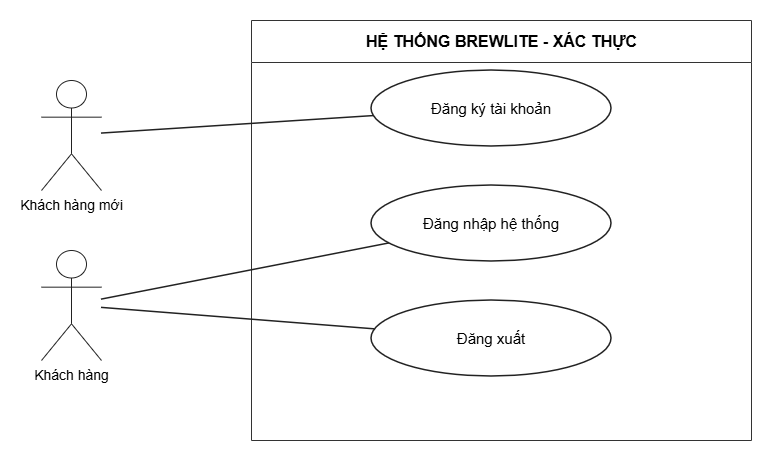

# Đặc tả Use-case phân hệ xác thực – BrewLite

## Sơ đồ Use-case đăng ký tài khoản

## 1. Đặc tả Use-case: Đăng ký tài khoản

**Thông tin cơ bản:**

- **Tên Use-case:** Đăng ký tài khoản.
- **Mã yêu cầu (Traceability):** FR-04 (Đăng ký tài khoản); NFR-03 (Bảo mật).
- **Actor:** Khách hàng mới.
- **Sự kiện kích hoạt (Trigger):** Khách hàng mới chọn chức năng "Đăng ký".

**Bảng đặc tả chi tiết:**

| Thuộc tính | Đặc tả chi tiết |
| :--- | :--- |
| **Mục đích** | Cho phép khách hàng mới tạo tài khoản sử dụng hệ thống BrewLite; mật khẩu được băm trước khi lưu vào PostgreSQL. |
| **Luồng chính** | 1. Khách hàng mở trang "Đăng ký". 2. Khách hàng nhập email, mật khẩu và xác nhận mật khẩu. 3. Hệ thống kiểm tra tính hợp lệ của thông tin và email chưa được sử dụng. 4. Hệ thống băm mật khẩu và lưu tài khoản mới vào PostgreSQL. 5. Hệ thống thông báo đăng ký thành công và chuyển khách hàng đến trang đăng nhập. |
| **Luồng phụ** | **- Email đã tồn tại:** Hệ thống thông báo email đã được đăng ký và yêu cầu sử dụng email khác. **- Thông tin không hợp lệ:** Email sai định dạng, mật khẩu dưới 8 ký tự hoặc mật khẩu xác nhận không khớp; hệ thống thông báo để khách hàng sửa. **- Lỗi hệ thống:** Không thể lưu dữ liệu; hệ thống thông báo đăng ký thất bại, không tạo tài khoản. |
| **Tiền điều kiện** | - Khách hàng chưa có tài khoản với email đăng ký. - Hệ thống đăng ký và cơ sở dữ liệu hoạt động. |
| **Hậu điều kiện** | - Tài khoản mới được lưu trong PostgreSQL. - Chỉ lưu mật khẩu đã băm, không lưu mật khẩu gốc. |

## 2. Đặc tả Use-case: Đăng nhập hệ thống

**Thông tin cơ bản:**

- **Tên Use-case:** Đăng nhập hệ thống.
- **Mã yêu cầu (Traceability):** FR-05 (Đăng nhập hệ thống); NFR-03 (Bảo mật).
- **Actor:** Khách hàng.
- **Sự kiện kích hoạt (Trigger):** Khách hàng chọn chức năng "Đăng nhập".

**Bảng đặc tả chi tiết:**

| Thuộc tính | Đặc tả chi tiết |
| :--- | :--- |
| **Mục đích** | Cho phép khách hàng truy cập tài khoản BrewLite bằng thông tin hợp lệ và nhận JWT để xác thực các yêu cầu tiếp theo. |
| **Luồng chính** | 1. Khách hàng mở trang "Đăng nhập". 2. Khách hàng nhập email và mật khẩu. 3. Hệ thống tìm tài khoản theo email và đối chiếu mật khẩu với giá trị băm đã lưu. 4. Khi thông tin hợp lệ, hệ thống phát hành token JWT. 5. Hệ thống ghi nhận trạng thái đăng nhập và chuyển khách hàng đến giao diện phù hợp. |
| **Luồng phụ** | **- Sai email hoặc mật khẩu:** Hệ thống thông báo thông tin đăng nhập không hợp lệ và cho phép nhập lại. **- Thiếu thông tin:** Hệ thống yêu cầu nhập đủ email và mật khẩu. **- Lỗi hệ thống:** Không thể kiểm tra tài khoản hoặc cấp JWT; hệ thống thông báo đăng nhập thất bại. |
| **Tiền điều kiện** | - Khách hàng đã có tài khoản trên BrewLite. - Hệ thống xác thực đang hoạt động. |
| **Hậu điều kiện** | - Khách hàng được xác thực thành công. - Hệ thống trả về JWT để sử dụng trong các yêu cầu cần đăng nhập. |

## 3. Đặc tả Use-case: Đăng xuất

**Thông tin cơ bản:**

- **Tên Use-case:** Đăng xuất.
- **Mã yêu cầu (Traceability):** Chưa có mã FR riêng trong SRS hiện tại (chức năng bổ sung của phân hệ xác thực).
- **Actor:** Khách hàng.
- **Sự kiện kích hoạt (Trigger):** Khách hàng nhấn nút "Đăng xuất".

**Bảng đặc tả chi tiết:**

| Thuộc tính | Đặc tả chi tiết |
| :--- | :--- |
| **Mục đích** | Cho phép khách hàng kết thúc phiên đăng nhập trên thiết bị hiện tại. |
| **Luồng chính** | 1. Khách hàng đã đăng nhập nhấn "Đăng xuất". 2. Hệ thống xóa token JWT và thông tin phiên đăng nhập đang lưu ở phía ứng dụng. 3. Hệ thống cập nhật giao diện về trạng thái chưa đăng nhập. 4. Khách hàng được chuyển về Trang chủ. |
| **Luồng phụ** | **- Phiên đăng nhập không còn hợp lệ:** Hệ thống vẫn xóa thông tin phiên đang lưu và đưa giao diện về trạng thái chưa đăng nhập. |
| **Tiền điều kiện** | - Khách hàng đang ở trạng thái đăng nhập trên ứng dụng. |
| **Hậu điều kiện** | - Ứng dụng không còn sử dụng JWT của phiên vừa đăng xuất. - Khách hàng phải đăng nhập lại để truy cập chức năng yêu cầu xác thực. |

