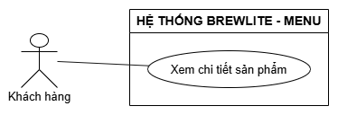
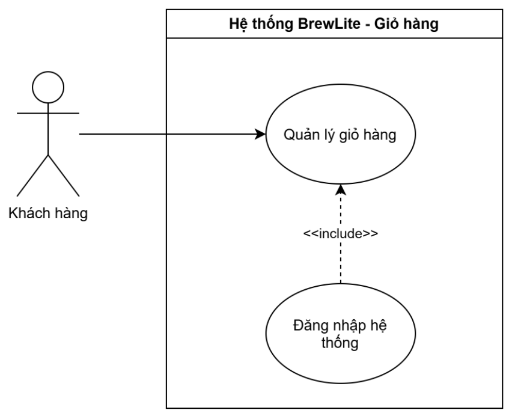
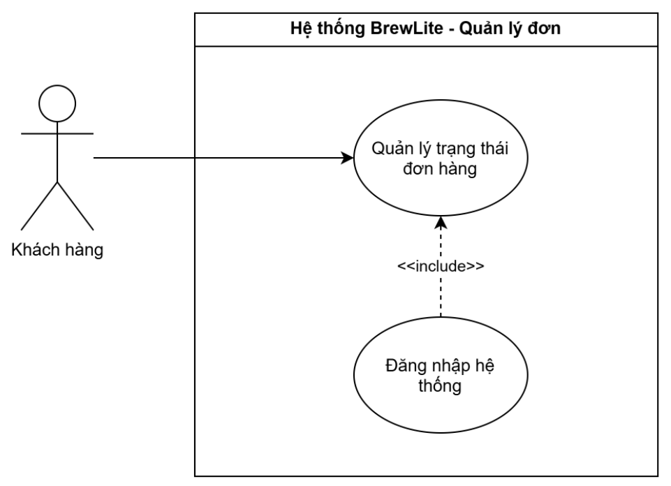
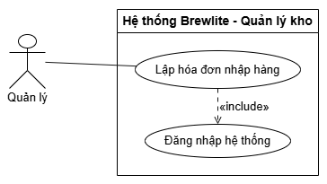
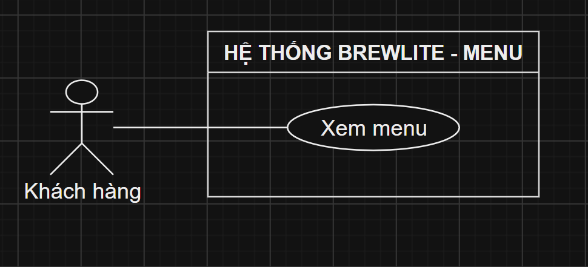
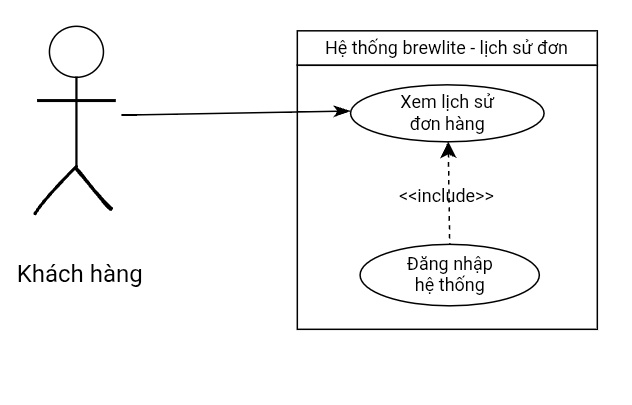

# Tài liệu Đặc tả Yêu cầu Hệ thống (SRS rút gọn) - BrewLite

## 1. Yêu cầu chức năng (Functional Requirements)

| Mã        | Tên yêu cầu                 | Nhóm tính năng      | Ưu tiên    | Tiêu chí chấp nhận (Acceptance Criteria)                                                                                          |
| :-------- | :-------------------------- | :------------------ | :--------- | :-------------------------------------------------------------------------------------------------------------------------------- |
| **FR-01** | Xem menu                    | Menu                | **Must**   | Hệ thống hiển thị danh sách sản phẩm.                                                                                             |
| **FR-02** | Xem chi tiết sản phẩm       | Menu                | **Must**   | Hiển thị giá, tên có thể chọn size/topping.                                                                                       |
| **FR-03** | Quản lý giỏ hàng            | Giỏ hàng            | **Must**   | Khách hàng có thể thêm/sửa/xóa sản phẩm. Tổng tiền cập nhật theo thời gian thực dựa trên các tùy chọn.                            |
| **FR-04** | Đăng ký tài khoản           | Xác thực            | **Must**   | Khách hàng mới có thể đăng ký tài khoản. Thông tin mật khẩu phải được mã hóa (hash) trước khi lưu vào PostgreSQL.                 |
| **FR-05** | Đăng nhập hệ thống          | Xác thực            | **Must**   | Người dùng đăng nhập thành công bằng tài khoản hợp lệ, hệ thống trả về token JWT để duy trì phiên đăng nhập.                      |
| **FR-06** | Phân quyền truy cập         | Phân quyền          | **Must**   | Hệ thống dựa vào JWT để cấp quyền: Khách hàng (chỉ đặt hàng), Nhân viên (cập nhật trạng thái đơn), Quản lý (được quyền nhập kho). |
| **FR-07** | Đặt và thanh toán đơn hàng  | Đặt đơn, Thanh toán | **Must**   | Tạo đơn hàng thành công để chuyển sang thanh toán.                                                                                |
| **FR-08** | Quản lý trạng thái đơn hàng | Quản lý đơn         | **Must**   | Nhân viên quầy có thể xem danh sách đơn realtime và chuyển trạng thái (Chờ xử lý -> Đang pha chế -> Hoàn thành).                  |
| **FR-09** | Xem lịch sử đơn hàng        | Lịch sử đơn         | **Should** | Khách hàng xem lại được danh sách các đơn đã đặt và trạng thái hiện tại của đơn hàng.                                             |
| **FR-10** | Lập hóa đơn nhập hàng       | Quản lý kho         | **Must**   | Quản lý tạo hóa đơn nhập hàng. Khi hóa đơn lưu thành công, số lượng tồn kho tương ứng tự động cộng dồn.                           |
| **FR-11** | Cập nhật tồn kho thủ công   | Quản lý kho         | **Won't**  | Tính năng tự thay đổi số lượng kho độc lập không qua hóa đơn nhập sẽ không được triển khai trong MVP này.                         |

## 2. Yêu cầu phi chức năng (Non-Functional Requirements)

| Mã         | Tên yêu cầu                         | Nhóm tính năng | Ưu tiên (MoSCoW) | Tiêu chí chấp nhận (Acceptance Criteria)                                                                                                 |
| :--------- | :---------------------------------- | :------------- | :--------------- | :--------------------------------------------------------------------------------------------------------------------------------------- |
| **NFR-01** | Tính khả dụng (Usability)           | Khả dụng       | **Must**         | Giao diện frontend bằng Next.js phải tuân thủ thiết kế mobile-first, có thể cài đặt như ứng dụng PWA trên điện thoại.                    |
| **NFR-02** | Tính hiệu năng (Performance)             | Hiệu năng      | **Should**       | Thời gian phản hồi của các API Backend (NestJS) thông thường không vượt quá 500ms.                                                       |
| **NFR-03** | Tính bảo mật (Security)                  | Bảo mật        | **Must**         | Toàn bộ mật khẩu lưu trong PostgreSQL phải được băm (hash). API yêu cầu quyền quản trị phải chặn các truy cập không có token hợp lệ.     |
| **NFR-04** | Tính triển khai (Deployability) | Triển khai     | **Must**         | Hệ thống phải có Dockerfile, docker-compose.yml và pipeline CI/CD tự động deploy lên môi trường production khi push code lên nhánh main. |

## 3. Sơ đồ Use-case tổng quát toàn hệ thống

## 4. Đặc tả Use-case trọng tâm: Đặt và thanh toán đơn hàng

**Thông tin cơ bản:**

- **Tên Use-case:** Đặt và thanh toán đơn hàng.
- **Mã yêu cầu (Traceability):** FR-07 (Đặt đơn/thanh toán), FR-03 (Giỏ hàng), FR-05 (Đăng nhập).
- **Actor:** Khách hàng.
- **Sự kiện kích hoạt (Trigger):** Khi khách hàng nhấn nút "Thanh toán" tại màn hình Giỏ hàng.

**Bảng đặc tả chi tiết:**

| Thuộc tính         | Đặc tả chi tiết                                                                                                                                                                                                                                                                                                                                                                                                                                                                                                                                       |
| :----------------- | :---------------------------------------------------------------------------------------------------------------------------------------------------------------------------------------------------------------------------------------------------------------------------------------------------------------------------------------------------------------------------------------------------------------------------------------------------------------------------------------------------------------------------------------------------- |
| **Mục đích**       | Cho phép khách hàng thanh toán và ghi nhận hóa đơn. Khi khách hàng chốt nước uống, đồ ăn.                                                                                                                                                                                                                                                                                                                                                                                                                                                             |
| **Luồng chính**    | 1. Khách hàng bấm nút "Thanh toán" ở trang giỏ hàng và chọn "Thanh toán qua mã QR". 2. Hệ thống tính tổng tiền, tạo Order ID và lưu vào database với trạng thái "Chờ thanh toán". 3. Hệ thống sinh mã QR chứa thông tin thanh toán hiển thị cho khách. 4. Khách hàng sử dụng app ngân hàng quét mã và chuyển tiền. 5. Cổng thanh toán gửi Webhook xác nhận giao dịch về BrewLite. 6. Hệ thống đối chiếu số tiền, cập nhật trạng thái đơn thành "Đã thanh toán". 7. Hệ thống xóa giỏ hàng và hiển thị thông báo đặt hàng thành công. |
| **Luồng phụ**      | **- Đổi ý:** Tại bước 3, nếu khách bấm "Quay lại", hệ thống hủy mã QR, đưa khách về lại giỏ hàng và giữ nguyên các món đã chọn. **- Quá hạn:** Sau 10 phút không có Webhook trả về, đơn hàng tự động chuyển sang "Đã hủy" do quá hạn. Khách phải đặt lại. **- Sai số tiền:** Tại bước 5, nếu Webhook báo số tiền nhận nhỏ hơn bill thực tế, đơn chuyển "Thanh toán thiếu". Khách cần liên hệ quầy xử lý. **- Lỗi database:** Tại bước 2, nếu PostgreSQL lỗi, báo "Lỗi do hệ thống" và giữ nguyên giỏ hàng.                                   |
| **Tiền điều kiện** | - Khách hàng đã đăng nhập thành công. - Giỏ hàng phải có sản phẩm. - Đã kết nối thành công với API cổng thanh toán.                                                                                                                                                                                                                                                                                                                                                                                                                             |
| **Hậu điều kiện**  | - Hóa đơn được tạo thành công trong PostgreSQL. - Giỏ hàng của khách hàng được làm trống.                                                                                                                                                                                                                                                                                                                                                                                                                                                          |

## 5. Đặc tả Use-case: Xem chi tiết sản phẩm

**Thông tin cơ bản:**

- **Tên Use-case:** Xem chi tiết sản phẩm.
- **Mã yêu cầu (Traceability):** FR-02 (Xem chi tiết sản phẩm); FR-01 (Xem menu); NFR-01 (Tính khả dụng); NFR-02 (Tính hiệu năng).
- **Actor:** Khách hàng.
- **Sự kiện kích hoạt (Trigger):** Khách hàng chọn một sản phẩm từ danh sách sản phẩm trên màn hình Menu.

**Bảng đặc tả chi tiết:**

| Thuộc tính | Đặc tả chi tiết |
| :--- | :--- |
| **Mục đích** | Cho phép khách hàng xem thông tin chi tiết của sản phẩm (tên, giá) và lựa chọn các tùy chọn đi kèm (size, topping). |
| **Luồng chính** | 1. Khách hàng chọn một sản phẩm từ danh sách trên trang "Menu". 2. Hệ thống truy xuất dữ liệu sản phẩm từ PostgreSQL. 3. Hệ thống hiển thị thông tin chi tiết gồm: tên sản phẩm, giá bán và các tùy chọn size/topping. 4. Khách hàng chọn size và topping mong muốn. 5. Hệ thống cập nhật mức giá hiển thị tương ứng với các tùy chọn đã chọn. |
| **Luồng phụ** | **- Sản phẩm không tồn tại:** Không tìm thấy thông tin sản phẩm trong cơ sở dữ liệu; hệ thống thông báo lỗi và đưa khách hàng quay lại trang Menu. **- Lỗi hệ thống:** Không thể truy xuất dữ liệu từ PostgreSQL; hệ thống thông báo lỗi tải dữ liệu. |
| **Tiền điều kiện** | - Hệ thống hiển thị danh sách sản phẩm (Menu) và cơ sở dữ liệu PostgreSQL đang hoạt động. |
| **Hậu điều kiện** | - Thông tin tên, giá và các tùy chọn size/topping của sản phẩm được hiển thị cho khách hàng. |

## 6. Đặc tả Use-case: Quản lý giỏ hàng

**Thông tin cơ bản:**

- **Tên Use-case:** Quản lý giỏ hàng.
- **Mã yêu cầu (Traceability):** FR-03 (Quản lý giỏ hàng); FR-05 (Đăng nhập hệ thống); NFR-01 (Tính khả dụng); NFR-02 (Tính hiệu năng).
- **Actor:** Khách hàng.
- **Sự kiện kích hoạt (Trigger):** Khách hàng đã chọn xong các sản phẩm cho mình và nhấn nút vào giỏ hàng.

**Bảng đặc tả chi tiết:**

| Thuộc tính | Đặc tả chi tiết |
| :--- | :--- |
| **Mục đích** | Cho khách hàng xem danh sách sản phẩm mà họ đã lựa chọn và tổng giá tiền của các sản phẩm đó. |
| **Luồng chính** | 1. Kiểm tra đăng nhập nếu đó là khách hàng (thực hiện bởi use case đăng nhập hệ thống). 2. Hiển thị giao diện danh sách sản phẩm khách đã chọn mua.  3. Khách hàng có thể xem những sản phẩm kèm chi tiết mà khách đã chọn.  4. Khách hàng có thể xóa sản phẩm không đúng theo khách chọn.  5. Khách hàng có thể xem được tổng giá của các sản phẩm đã chọn mua.  6. Khách hàng có thể nhấn nút quay lại menu để lựa chọn tiếp.  7. Khách hàng bấm xác nhận đặt hàng để thanh toán và đóng giao diện giỏ hàng. |
| **Luồng phụ** | 1. Đăng nhập không hợp lệ.  2. Khách hàng lỡ đặt hàng khi chưa chọn hết sản phẩm mình cần. |
| **Tiền điều kiện** | 1. Đăng nhập phải là của tài khoản khách hàng.  2. Khách hàng phải chọn sản phẩm đầu tiên trước khi vào giỏ hàng. |
| **Hậu điều kiện** | 1. Giỏ hàng không được trống.  2. Xác nhận đặt hàng trước khi chuyển sang thanh toán. |

## 7. Đặc tả Use-case: Quản lý trạng thái đơn hàng

**Thông tin cơ bản:**

- **Tên Use-case:** Quản lý trạng thái đơn hàng.
- **Mã yêu cầu (Traceability):** FR-10 (Quản lý trạng thái đơn hàng); FR-05 (Đăng nhập hệ thống); FR-06 (Phân quyền truy cập); FR-07 (Đặt và thanh toán đơn hàng); NFR-03 (Tính bảo mật).
- **Actor:** Nhân viên.
- **Sự kiện kích hoạt (Trigger):** Khách hàng xác nhận đặt hàng và thực hiện thanh toán nếu có.

**Bảng đặc tả chi tiết:**

| Thuộc tính | Đặc tả chi tiết |
| :--- | :--- |
| **Mục đích** | Cho nhân viên xem danh sách sản phẩm đặt hàng của khách và cập nhật trạng thái đơn hàng. |
| **Luồng chính** | 1. Kiểm tra đăng nhập nếu đó là nhân viên (thực hiện bởi use case đăng nhập hệ thống).  2. Hiển thị giao diện trạng thái đơn hàng.  3. Nhân viên kiểm tra và cập nhật trạng thái đơn hàng theo 3 trạng thái “PENDING”, “PAID”, “CANCELLED”.  4. Xác nhận lưu trạng thái và đóng giao diện. |
| **Luồng phụ** | 1. Đăng nhập không hợp lệ.  2. Nhân viên chỉnh không đúng trạng thái đơn hàng theo dự kiến.  3. Nhân viên không xác nhận lưu mỗi khi đóng giao diện. |
| **Tiền điều kiện** | 1. Đăng nhập phải là của tài khoản nhân viên.  2. Khách hàng phải xác nhận giỏ hàng để thanh toán. |
| **Hậu điều kiện** | 1. Xác nhận lưu trước khi đóng giao diện. |

## 8. Đặc tả Use-case: Lập hóa đơn nhập hàng

**Thông tin cơ bản:**

- **Tên Use-case:** Lập hóa đơn nhập hàng.
- **Mã yêu cầu (Traceability):** FR-10 (Lập hóa đơn nhập hàng); FR-05 (Đăng nhập hệ thống); FR-06 (Phân quyền truy cập); NFR-03 (Bảo mật).
- **Actor:** Quản lý.
- **Sự kiện kích hoạt (Trigger):** Quản lý chọn chức năng "Lập hóa đơn nhập hàng".

**Bảng đặc tả chi tiết:**

| Thuộc tính | Đặc tả chi tiết |
| :--- | :--- |
| **Mục đích** | Cho phép Quản lý tạo hóa đơn nhập hàng; khi hóa đơn lưu thành công, số lượng tồn kho tương ứng tự động cộng dồn. |
| **Luồng chính** | 1. Quản lý mở chức năng "Lập hóa đơn nhập hàng". 2. Hệ thống kiểm tra token JWT để xác thực phiên đăng nhập và quyền Quản lý. 3. Quản lý nhập thông tin hóa đơn nhập hàng và số lượng hàng nhập, sau đó nhấn lưu. 4. Hệ thống kiểm tra tính hợp lệ của thông tin hóa đơn. 5. Hệ thống lưu hóa đơn nhập hàng vào PostgreSQL và tự động cộng dồn số lượng tồn kho tương ứng. 6. Hệ thống thông báo lập hóa đơn nhập hàng thành công. |
| **Luồng phụ** | **- Không có quyền truy cập:** Yêu cầu không có token JWT hợp lệ hoặc tài khoản không thuộc quyền Quản lý; API chặn truy cập theo quy định bảo mật. **- Thông tin không hợp lệ:** Dữ liệu nhập thiếu hoặc số lượng không hợp lệ; hệ thống thông báo để Quản lý sửa lại. **- Lỗi hệ thống:** Không thể lưu dữ liệu vào PostgreSQL; hệ thống thông báo tạo hóa đơn thất bại, số lượng tồn kho giữ nguyên không thay đổi. |
| **Tiền điều kiện** | - Quản lý đã đăng nhập thành công vào hệ thống và có token JWT hợp lệ với quyền Quản lý. - Hệ thống quản lý kho và cơ sở dữ liệu PostgreSQL hoạt động bình thường. |
| **Hậu điều kiện** | - Hóa đơn nhập hàng mới được lưu thành công trong PostgreSQL. - Số lượng tồn kho tương ứng được tự động cộng dồn. |

## 9. Đặc tả Use-case: Xem menu

**Thông tin cơ bản:**

- **Tên Use-case:** Xem menu.
- **Mã yêu cầu (Traceability):** FR-01 (Xem menu); NFR-01 (Tính khả dụng); NFR-02 (Tính hiệu năng).
- **Actor:** Khách hàng.
- **Sự kiện kích hoạt (Trigger):** Khách hàng truy cập vào ứng dụng BrewLite hoặc chọn chức năng "Menu" trên giao diện.

**Bảng đặc tả chi tiết:**

| Thuộc tính | Đặc tả chi tiết |
| :--- | :--- |
| **Mục đích** | Cho phép khách hàng xem danh sách các sản phẩm hiện có trên hệ thống BrewLite. |
| **Luồng chính** | 1. Khách hàng mở trang "Menu" trên ứng dụng. 2. Hệ thống truy xuất danh sách sản phẩm từ cơ sở dữ liệu PostgreSQL. 3. Hệ thống hiển thị danh sách sản phẩm (gồm tên sản phẩm, giá bán, hình ảnh) lên giao diện cho khách hàng. 4. Khách hàng xem danh sách sản phẩm và có thể chọn một sản phẩm bất kỳ nếu muốn xem chi tiết. |
| **Luồng phụ** | **- Danh sách sản phẩm trống:** Chưa có dữ liệu sản phẩm trong cơ sở dữ liệu; hệ thống hiển thị thông báo hiện chưa có sản phẩm nào trên menu. **- Lỗi hệ thống:** Không thể truy xuất dữ liệu từ PostgreSQL; hệ thống thông báo lỗi tải dữ liệu. |
| **Tiền điều kiện** | - Hệ thống ứng dụng và cơ sở dữ liệu PostgreSQL đang hoạt động bình thường. |
| **Hậu điều kiện** | - Danh sách sản phẩm được hiển thị thành công trên màn hình Menu cho khách hàng. |

## 10. Đặc tả Use-case: Xem lịch sử đơn hàng

**Thông tin cơ bản**

- **Tên Use-case:** Xem lịch sử đơn hàng.
- **Mã yêu cầu (Traceability):** FR-07 (Xem lịch sử đơn hàng); NFR-01 (Tính khả dụng); NFR-02 (Tính hiệu năng).
- **Actor:** Khách hàng.
- **Sự kiện kích hoạt (Trigger):** Khách hàng đã đặt đơn và thanh toán muốn xem lại lịch sử.

**Bảng đặc tả chi tiết:**

| Thuộc tính | Đặc tả chi tiết |
| :--- | :--- |
| **Mục đích** | Khách hàng chọn xem lịch sử đơn hàng và xem trạng thái các đơn của mình. |
| **Luồng chính** | 1. Kiểm tra đăng nhập nếu tài khoản đã đăng ký. 2. Hiển thị giao diện lịch sử đơn hàng. 3. khách hàng xem lại đc danh sách các đơn đã đặt, chi tiết từng món và trạng thái cuối cùng của đơn. |
| **Luồng phụ** | 1. Khách hàng chưa có tài khoản.  2. Khách hàng chưa đặt và thanh toán đơn nào.|
| **Tiền điều kiện** | 1. Khách hàng đã có tài khoản đã đăng ký và đăng nhập vào hệ thống.  2. Khách hàng phải có ít nhất một đơn hàng đã đặt và thanh toán. |
| **Hậu điều kiện** | - Khách hàng xem được lịch sử đơn hàng của mình. |
