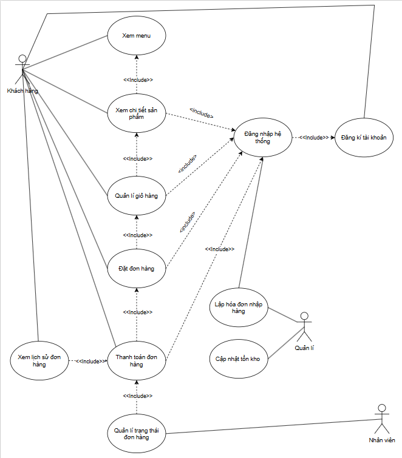

# Tài liệu Đặc tả Yêu cầu Hệ thống (SRS rút gọn) - BrewLite

## 1. Yêu cầu chức năng (Functional Requirements)

| Mã        | Tên yêu cầu                   | Nhóm tính năng | Ưu tiên    | Tiêu chí chấp nhận (Acceptance Criteria)                                                                                          |
| :-------- | :---------------------------- | :------------- | :--------- | :-------------------------------------------------------------------------------------------------------------------------------- |
| **FR-01** | Xem menu và chi tiết sản phẩm | Menu           | **Must**   | Hệ thống hiển thị danh sách sản phẩm. Khi bấm vào, hiển thị chi tiết (ảnh, giá, mô tả, tùy chọn size/topping).                    |
| **FR-02** | Quản lý giỏ hàng              | Giỏ hàng       | **Must**   | Khách hàng có thể thêm/sửa/xóa sản phẩm. Tổng tiền cập nhật theo thời gian thực dựa trên các tùy chọn.                            |
| **FR-03** | Đăng ký tài khoản             | Xác thực       | **Must**   | Khách hàng mới có thể đăng ký tài khoản. Thông tin mật khẩu phải được mã hóa (hash) trước khi lưu vào PostgreSQL.                 |
| **FR-04** | Đăng nhập hệ thống            | Xác thực       | **Must**   | Người dùng đăng nhập thành công bằng tài khoản hợp lệ, hệ thống trả về token JWT để duy trì phiên đăng nhập.                      |
| **FR-05** | Phân quyền truy cập           | Phân quyền     | **Must**   | Hệ thống dựa vào JWT để cấp quyền: Khách hàng (chỉ đặt hàng), Nhân viên (cập nhật trạng thái đơn), Quản lý (được quyền nhập kho). |
| **FR-06** | Lập đơn hàng                  | Đặt đơn        | **Must**   | Tạo đơn hàng thành công để chuyển sang thanh toán.                                                                                |
| **FR-07** | Thanh toán đơn hàng           | Thanh toán     | **Must**   | Hiển thị thanh toán mô phỏng (mã QR). Thanh toán thành công thì chuyển trạng thái thành công.                                     |
| **FR-08** | Quản lý trạng thái đơn hàng   | Quản lý đơn    | **Must**   | Nhân viên quầy có thể xem danh sách đơn realtime và chuyển trạng thái (Chờ xử lý -> Đang pha chế -> Hoàn thành).                  |
| **FR-09** | Xem lịch sử đơn hàng          | Lịch sử đơn    | **Should** | Khách hàng xem lại được danh sách các đơn đã đặt và trạng thái hiện tại của đơn hàng.                                             |
| **FR-10** | Lập hóa đơn nhập hàng         | Quản lý kho    | **Must**   | Quản lý tạo hóa đơn nhập hàng. Khi hóa đơn lưu thành công, số lượng tồn kho tương ứng tự động cộng dồn.                           |
| **FR-11** | Cập nhật tồn kho thủ công     | Quản lý kho    | **Won't**  | Tính năng tự thay đổi số lượng kho độc lập không qua hóa đơn nhập sẽ không được triển khai trong MVP này.                         |

## 2. Yêu cầu phi chức năng (Non-Functional Requirements)

| Mã         | Tên yêu cầu                         | Nhóm tính năng | Ưu tiên (MoSCoW) | Tiêu chí chấp nhận (Acceptance Criteria)                                                                                                 |
| :--------- | :---------------------------------- | :------------- | :--------------- | :--------------------------------------------------------------------------------------------------------------------------------------- |
| **NFR-01** | Tính khả dụng (Usability)           | Khả dụng       | **Must**         | Giao diện frontend bằng Next.js phải tuân thủ thiết kế mobile-first, có thể cài đặt như ứng dụng PWA trên điện thoại.                    |
| **NFR-02** | Hiệu năng (Performance)             | Hiệu năng      | **Should**       | Thời gian phản hồi của các API Backend (NestJS) thông thường không vượt quá 500ms.                                                       |
| **NFR-03** | Bảo mật (Security)                  | Bảo mật        | **Must**         | Toàn bộ mật khẩu lưu trong PostgreSQL phải được băm (hash). API yêu cầu quyền quản trị phải chặn các truy cập không có token hợp lệ.     |
| **NFR-04** | Khả năng triển khai (Deployability) | Triển khai     | **Must**         | Hệ thống phải có Dockerfile, docker-compose.yml và pipeline CI/CD tự động deploy lên môi trường production khi push code lên nhánh main. |

## 3. Sơ đồ Use-case tổng quát toàn hệ thống

